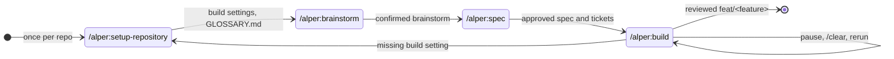
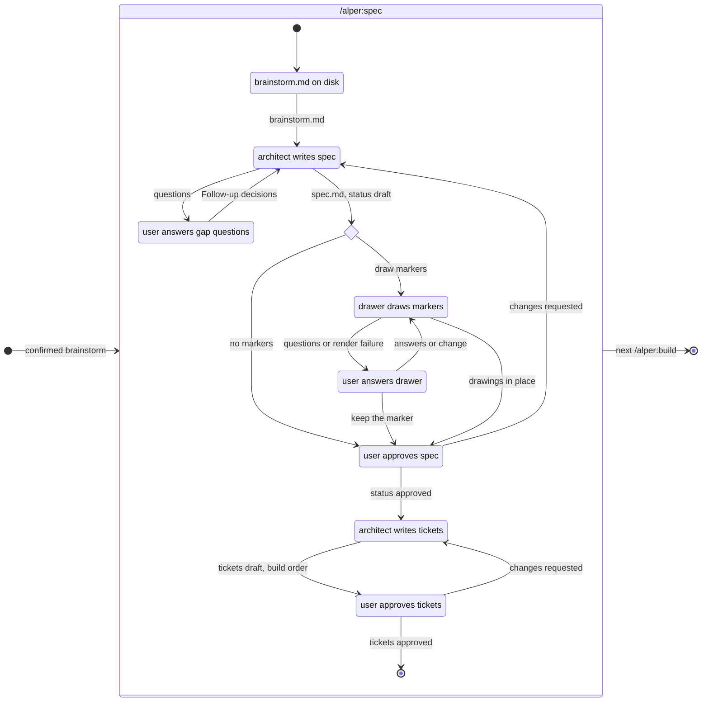
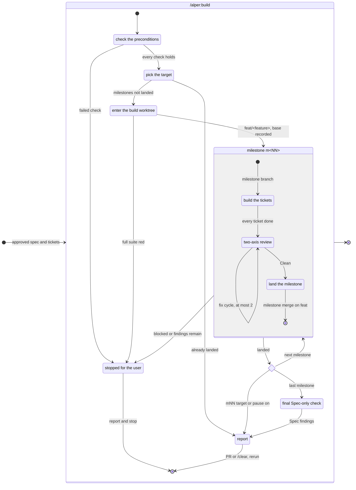
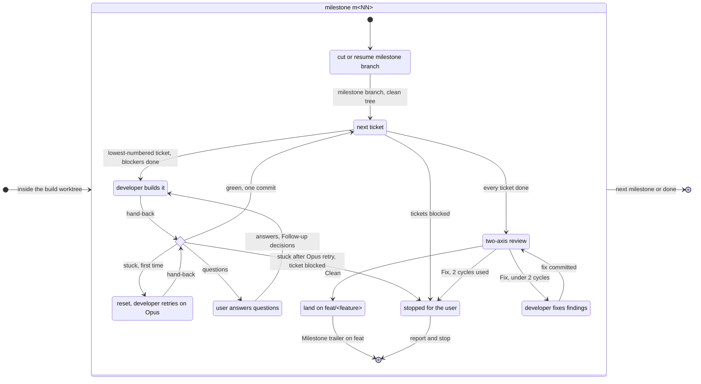

# Workflow

How a feature moves through alper, from `/alper:setup-repository` to a reviewed `feat/<feature>` branch: an overview, then `/alper:spec`, `/alper:build` and one milestone in detail.

## Overview

## /alper:spec

## /alper:build

## One milestone

