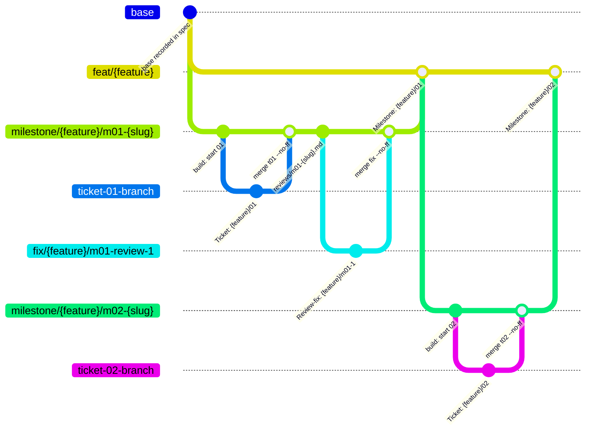
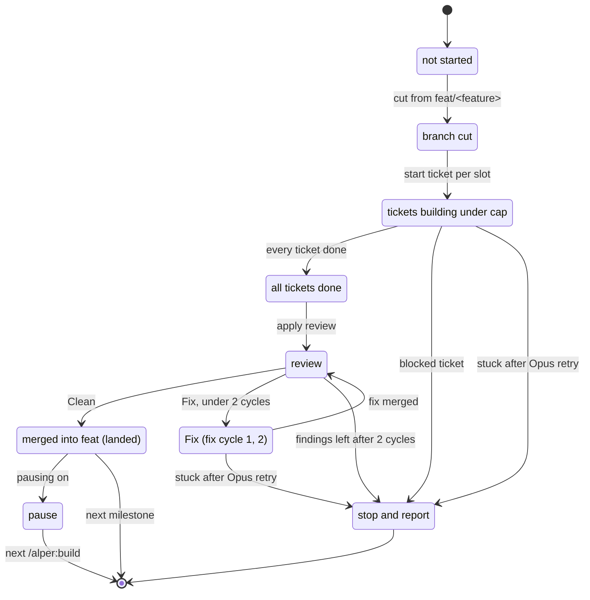

# Spec: Milestone builds

## Problem Statement

When I run `/alper:build` today, every ticket in the frontier starts at once, however many there are, and every finished ticket merges straight into `feat/<feature>`. The only review runs once, at the very end, over the whole feature. So the feature branch holds unreviewed work for most of the build, a large feature gets one review that is too big to read well, there is no point where I can demo a working slice, and a wide frontier starts more developers and test suites than my machine can run. Smaller gaps compound this: a base branch that was already red makes the first tickets look broken, a developer that cannot get green marks its ticket blocked with no second attempt, two parallel tickets in the same module collide at merge time, every worktree needs dependencies installed by hand, and the answers I give developers mid-build are lost once the build ends.

## Solution

The architect groups the tickets into **milestones**: each one delivers specific user stories I can demo. `/alper:build` works one milestone at a time. Each milestone gets its own **milestone branch** cut from `feat/<feature>`; its tickets are built under a **parallel cap** I choose in setup, merged into the milestone branch one at a time, and the milestone is reviewed on both axes, with up to two **fix cycles**. Only a Clean milestone merges into `feat/<feature>`, so the feature branch only ever receives reviewed milestones. After the last milestone, a final Spec-only check reports on the feature as a whole.

`/alper:setup-repository` asks for the build settings (parallel cap, whether test suites can run at the same time, whether to pause between milestones, and the install command) and writes them into the `## Agent workflow` block. The build checks the base is green before it starts, avoids running two tickets that touch the same module, retries a stuck ticket once on Opus, runs the install command in every new worktree, and writes my answers to developer questions back to `brainstorm.md`. I can also target one milestone (`mNN`) or one ticket (`tNN`). A spec with no milestones builds as a single milestone, so older specs keep working.

## User Stories

1. As a developer, I want the architect to declare milestones in the spec, each delivering specific user stories I can demo, so that the build has review and demo points that mean something to me.
2. As a developer, I want every new spec to declare at least one milestone, so that every new feature builds the same way.
3. As a developer, I want each ticket to name its milestone and the modules it touches, so that the build can schedule and scope it from the ticket files alone.
4. As a developer, I want the architect to keep every ticket's blockers in its own milestone or an earlier one, so that a milestone never waits on later work.
5. As a developer, I want the build to refuse to start when a ticket depends on a later milestone, has no milestone while the spec declares milestones, or names an undeclared milestone, so that a broken breakdown never half-runs.
6. As a developer, I want a spec with no `## Milestones` section to build as one implicit milestone with the full milestone flow, so that specs written before this feature still build.
7. As a developer, I want each milestone built on its own milestone branch cut from `feat/<feature>` after the previous milestone lands, so that each milestone starts from reviewed work.
8. As a developer, I want each ticket cut from the milestone branch and merged back into it one at a time with `--no-ff`, so that every ticket stays verifiable and revertible on its own.
9. As a developer, I want `feat/<feature>` to receive only milestone merges, each `--no-ff` with a `Milestone: <feature>/<NN>` trailer, so that the feature branch's history reads as reviewed milestones.
10. As a developer, I want each milestone reviewed on both axes against `feat/<feature>`, scoped to that milestone's tickets and user stories, so that each review is small enough to read and measures only what the milestone promised.
11. As a developer, I want each milestone's review report saved under the feature's `reviews/` directory and committed on the milestone branch, each later review replacing it in a new commit, so that I can read the latest verdict in the tree and every earlier one in history.
12. As a developer, I want gaps and hard violations fixed in at most two fix cycles per milestone, then the build to stop and report what is left, so that fixes are bounded and the rest is my call.
13. As a developer, I want a final Spec-only check across the whole feature after the last milestone lands, reporting findings without starting a fix cycle, so that I see anything that falls between milestones before I open the PR.
14. As a developer, I want the final Spec-only check skipped when the spec declares no milestones, so that a single implicit milestone is not reviewed twice.
15. As a developer, I want no more tickets dispatched at once than my parallel cap, counting every dispatched ticket not yet merged, and new tickets started one at a time as slots free up, so that the build never overloads my machine.
16. As a developer, I want the ticket at the head of the longest dependency chain in the current milestone to start first, then the lowest ticket number, so that the milestone's critical path is never left waiting.
17. As a developer, I want the build to avoid running two tickets that touch the same module at once, but to fill a free slot anyway when nothing else is ready, so that merge conflicts drop without idling the build.
18. As a developer, I want only dispatched tickets marked `in-progress`, the rest left `todo`, so that the ticket files show what is actually running.
19. As a developer, I want setup to ask for the parallel cap, whether test suites can run at the same time, whether to pause between milestones, and the install command, and write them as lines in the `## Agent workflow` block, so that the build reads its settings from the repo.
20. As a developer, I want the parallel cap to default to 3, or to 1 when test suites cannot run at the same time, so that the default is safe for my test setup.
21. As a developer, I want setup to work out the install command from the lockfile or manifest and ask me to confirm it, so that I do not have to remember it.
22. As a developer, I want a setup re-run to ask only for settings missing from the block, so that upgrading alper does not re-ask what I already answered.
23. As a developer, I want every build mode to stop and ask me to re-run `/alper:setup-repository` when a build setting is missing, so that the build never runs on a guessed setting.
24. As a developer, I want each developer to run the install command right after cutting its branch, so that every worktree can run the tests.
25. As a developer, I want the build to pause between milestones only when the setting is on, off by default, with `--pause` or `--no-pause` overriding it for one run, and to resume when I run `/alper:build` again, so that I can demo each milestone when I want to.
26. As a developer, I want the first run to check that the full suite is green on the base before `feat/<feature>` exists, and to stop with the failures when it is red, so that tickets are never blamed for a broken base.
27. As a developer, I want a developer that hands back stuck to be retried once from scratch on Opus, with the stuck report in its prompt, before the ticket is marked blocked, so that a hard ticket gets one stronger attempt.
28. As a developer, I want a stuck review-fix developer retried once on Opus, then the build to stop and report the remaining findings, so that review fixes get the same second attempt.
29. As a developer, I want a merge the merger cannot get green to come straight to me, so that integration problems are never retried blindly.
30. As a developer, I want my answers to a developer's questions appended to `brainstorm.md` under `## Follow-up decisions`, committed on the current milestone branch and passed to the developer, so that decisions made during the build are kept with the feature while the approved spec stays unchanged.
31. As a developer, I want a stopped build to resume from `feat/<feature>`'s `Milestone:` trailers, the ticket statuses and the saved review reports, so that a crash costs no landed milestone, merged ticket or used fix cycle.
32. As a developer, I want `/alper:build [feature] mNN` to run the full milestone flow for milestone NN only, then stop, so that I can land one milestone at a time.
33. As a developer, I want `/alper:build [feature] tNN` to merge one ticket into its milestone branch, creating the branch if needed, with no review, so that I can drive single tickets by hand.
34. As a developer, I want `/alper:build [feature] mNN tNN` to act as `tNN` and refuse when the ticket is not in milestone NN, so that I can guard a targeted run against a wrong number.
35. As a developer, I want a targeted run whose prerequisites have not landed to refuse and name what must land first and the command that lands it, so that I never build on missing work.
36. As a developer, I want a targeted run whose target already landed, and a plain run on a fully landed feature, to say so and change nothing, so that re-running is always safe.
37. As a developer, I want `/alper:review` to work as it does today when I run it myself, so that reviewing any branch is unaffected by milestones.

## Milestones

### M01 milestone-flow
- User stories: 1, 2, 3, 4, 5, 6, 7, 8, 9, 10, 11, 12, 13, 14, 15, 16, 18, 19, 20, 22, 23, 31, 37
- Success criteria: the sample-repo run shows 2 milestones, a cap below the frontier respected, one review per milestone, and `feat` receiving only milestone merges; a spec with no `## Milestones` section builds as one implicit milestone with no final Spec-only check; killing the build mid-milestone and re-running it finishes without redoing a landed milestone, a merged ticket or a used fix cycle; the build refuses each broken breakdown and each missing setting before writing anything.

### M02 targeted-and-resilient
- User stories: 17, 21, 24, 25, 26, 27, 28, 29, 30, 32, 33, 34, 35, 36
- Success criteria: a red base stops the first run before `feat/<feature>` exists; a stuck ticket gets exactly one Opus retry before it is blocked; a developer's question and its answer land in `brainstorm.md` on the milestone branch; `mNN`, `tNN` and `mNN tNN` behave as specified, including refusals and already-landed runs; pausing follows the setting and the flags; every worktree runs the install command; two tickets touching the same module do not run together while another ready ticket exists.

## Implementation Decisions

Paths below are artifact contracts the skills depend on, as in the alper-framework spec, not implementation file paths. Every module changed is an alper skill, agent or reference; the plugin stays markdown skills and agents, and every changed skill must pass the structure contract.



### Artifacts reference (single source of truth for formats)

All new formats live here; every skill points at it, as today.

- **Layout** gains `docs/.specs/<feature>/reviews/m<NN>-<slug>.md`, the latest review report of a milestone.
- **Spec** gains a `## Milestones` section between User Stories and Implementation Decisions. Its contract:

  ```markdown
  ## Milestones

  ### M01 <slug>
  - User stories: <story numbers>
  - Success criteria: <the Success Criteria this milestone makes checkable>
  ```

  `NN` is two digits, from 01, in landing order. Every user story belongs to exactly one milestone. A Success Criterion listed under no milestone is checked by the final Spec-only check only.
- **Ticket frontmatter** gains two fields:

  ```yaml
  milestone: "01"             # the milestone this ticket lands in
  touches: ["build", "merge-ticket"]  # the modules this ticket changes, as named in the spec
  ```

  Two tickets touch the same module when their `touches` lists share an entry.
- **Ticket status**: `in-progress` is set only on a dispatched ticket. `blocked` is set by the merger (a merge it cannot get green) or by `/alper:build` (a ticket still stuck after its Opus retry).
- **Milestone landed**: `feat/<feature>` holds a merge commit with the trailer `Milestone: <feature>/<NN>`. This is the only test for "landed".
- **Implicit milestone**: a spec with no `## Milestones` section has one milestone, `01`, slug `<feature>`. Its tickets need no `milestone` field; a ticket naming any milestone but `01` names an undeclared milestone.
- **Branches and commits**:

  | Thing | Name |
  |---|---|
  | Feature branch | `feat/<feature>`, created from `base`; receives only milestone merges |
  | Milestone branch | `milestone/<feature>/m<NN>-<slug>`, cut from `feat/<feature>` after the previous milestone lands |
  | Ticket branch | the ticket's `branch` field, cut from its milestone branch |
  | Review-fix branch | `fix/<feature>/m<NN>-review-<cycle>`, cut from the milestone branch |
  | Developer commit | trailer `Ticket: <feature>/NN`, or `Review-fix: <feature>/m<NN>-<cycle>` |
  | Ticket and review-fix merge | into the milestone branch, `--no-ff`, the merged commit's title and trailer |
  | Milestone merge | into `feat/<feature>`, `--no-ff`, trailer `Milestone: <feature>/<NN>` |

- The **integration branch** of a ticket or review fix is its milestone branch. Developers and the merger receive it as a parameter instead of assuming `feat/<feature>`.
- **Fix cycles used** by a milestone are counted from the `Review-fix: <feature>/m<NN>-<cycle>` trailers on its milestone branch.
- **Follow-up decisions** made during a build are appended to `brainstorm.md` under `## Follow-up decisions` as a `Build · t<NN> (<date>):` entry listing each question and answer, mirroring the existing `Spec · round <n>` entries.

### `setup-repository` (process skill, user-invoked)

- Explore also finds the lockfile or manifest and derives the install command from it (`none` when the repo needs no install).
- The one round of questions also asks each build setting missing from the block. On a first run that is all four; on a re-run, only the missing ones:
  - **Parallel test suites**: can two copies of the test suite run at the same time? ✅ yes.
  - **Parallel cap**: ✅ the default, 3, or 1 when test suites cannot run at the same time; or another number.
  - **Pause between milestones**: ✅ off.
  - **Install command**: the derived command; confirm or correct.
- The block gains four bullets, written and updated in place with the rest of the block:

  ```markdown
  - Parallel cap: 3
  - Parallel test suites: yes
  - Pause between milestones: off
  - Install command: npm ci
  ```

  `Parallel test suites` is `yes` or `no`, `Pause between milestones` is `on` or `off`, `Install command` is a command or `none`. Existing values survive a re-run unchanged.

### `write-spec` (process skill, architect)

- The spec template gains the `## Milestones` section from the Artifacts reference; every new spec has one, even with a single milestone.
- The architect groups user stories into milestones that each deliver something demoable. Computed waves are not milestones.

### `write-tickets` (process skill, architect)

- Every ticket gets `milestone` and `touches` (module names as the spec names them).
- A new check before writing: every `blocked-by` id is in the ticket's own milestone or an earlier one; the architect fixes the breakdown until it holds.
- The breakdown table gains `Milestone` and `Touches` columns, and the frontier waves are listed per milestone. `/alper:spec` shows them unchanged.

### `build` (process skill, user-invoked; the orchestrator)

Argument hint becomes `[feature] [mNN] [tNN] [--pause|--no-pause]`. The bare `NN` argument is replaced by `tNN`.



**Preconditions, every mode, before anything is written:**

1. `spec.md` has `status: approved` and `tickets: approved`; the working tree is clean.
2. All four build settings are in the `## Agent workflow` block; otherwise stop and ask the user to re-run `/alper:setup-repository`.
3. The breakdown is valid: when the spec declares milestones, every ticket has a `milestone` that is declared; every `blocked-by` id is in the same or an earlier milestone. Otherwise stop and name each broken ticket.
4. In `mNN tNN` mode, ticket NN's `milestone` is NN; otherwise refuse.

**First run** (`feat/<feature>` does not exist), any mode: run the full suite on the current branch. Red → stop and report the failures, writing nothing. Green → record `base` in the spec frontmatter and commit it on the base branch, as today, then create `feat/<feature>`.

**Targets and prerequisites:**

| Mode | Target | Prerequisites | Already landed |
|---|---|---|---|
| plain | every milestone not yet landed, in order | none | every milestone landed → report it and stop, changing nothing |
| `mNN` | milestone NN | every earlier milestone landed | milestone NN landed → report it and stop |
| `tNN`, `mNN tNN` | ticket NN | every earlier milestone landed; every `blocked-by` ticket `done` | ticket `done` → report it and stop |

An unmet prerequisite refuses the run and names what must land first and the command that lands it (`/alper:build <feature> mNN` for a milestone, `/alper:build <feature> tNN` for a ticket).

**The main checkout** belongs to the build and the merger. The build switches it to the integration branch the next merge needs: the milestone branch while tickets and fixes merge, `feat/<feature>` for the milestone merge.

**Milestone flow** (plain runs each target milestone in order; `mNN` runs it once):

1. **Cut or resume the milestone branch.** Absent → cut it from `feat/<feature>`. Present → switch to it and resume its `in-progress` tickets: a ticket branch with exactly one commit on top of the milestone branch's history goes to the merger; otherwise remove the leftover worktree and branch and set the ticket back to `todo`.
2. **Schedule under the cap.** The frontier is the milestone's `todo` tickets whose blockers are all `done`. A slot is free while fewer dispatched-but-unmerged tickets exist than `Parallel cap` (a ticket waiting for the merger still holds its slot). Each time a slot frees, start one ticket: rank the frontier by the length of the longest dependency chain each ticket heads within the current milestone, then by lowest number; take the first one that touches no module a running ticket touches; when every frontier ticket overlaps, take the first one anyway. Set it `in-progress` in its own commit (`build: start NN`) on the milestone branch, then dispatch its developer in the background with the feature, the integration branch, the ticket path, its branch and the install command.
3. **Questions.** A developer that returns questions → put them to the user, append the answers to `brainstorm.md` as a follow-up decision, commit it on the milestone branch, and resume the developer with the answers.
4. **Stuck.** A developer that hands back `stuck` → remove its worktree and branch, and dispatch a fresh developer for the same ticket with the model overridden to Opus and the stuck report in its prompt. It keeps the ticket's slot. Stuck again → mark the ticket `blocked` with a `## Blocked` section naming the failing check, commit it on the milestone branch, let running developers finish and merge, then stop and report.
5. **Merge.** Each green hand-back goes to the merger with the ticket, branch, worktree and integration branch, one merger at a time. `blocked` from the merger → let running developers finish and merge, then stop and report; no retry.
6. **Review.** When every ticket of the milestone is `done`, apply `review` with the milestone scope: fixed point `feat/<feature>`, the milestone's tickets, user stories and success criteria. Write the combined report to `reviews/m<NN>-<slug>.md` and commit it on the milestone branch, replacing any earlier one.
   - **Clean** → step 7.
   - **Fix**, fewer than 2 fix cycles used → dispatch one developer with the gaps and hard violations and the cycle number on `fix/<feature>/m<NN>-review-<cycle>`; a stuck fix developer gets one Opus retry, then the build stops and reports the remaining findings. Merge the fix through the merger, then review again.
   - **Fix**, 2 fix cycles used → stop and report the remaining findings.
7. **Land.** Switch the main checkout to `feat/<feature>` and dispatch the merger to merge the milestone branch with the `Milestone:` trailer.
8. **Pause.** When more target milestones remain and pausing is on (the setting, overridden by `--pause` or `--no-pause` for this run), report the landed milestone and end the turn; the next `/alper:build` resumes.

On resume of a milestone whose tickets are all `done`: when the milestone branch's tip is the commit of its saved review report, act on that report's verdict; otherwise review again.

**Ticket mode** (`tNN`, `mNN tNN`): cut or switch to the ticket's milestone branch, then run steps 2–5 for that ticket only. No review, no milestone merge.

**Final Spec-only check:** in whichever run lands the last milestone (plain or `mNN`), apply `review` on the Spec axis only, on `feat/<feature>` against `base`, over every ticket and the whole spec. Its findings go in the final report only; no fix cycle starts. Skipped when the spec declares no milestones.

**Report:**

```
feature:      <feature> on feat/<feature> (from <base>)
milestones:   M<NN> <slug>: landed | in review | building | not started — tickets NN, NN; review clean after <n> fix cycles
final check:  <Spec findings> | none | skipped (no declared milestones) | not yet (milestones remain)
smells:       <judgement calls and extras for the user to decide>
next:         /alper:build <feature> | gh pr create --base <base> --head feat/<feature>
```

**Stop conditions** stay as today, plus: findings left after two fix cycles, a ticket or fix still stuck after its Opus retry, a missing setting, an invalid breakdown, a red base.

### `implement-ticket` (process skill, developer)

- Takes the integration branch as a parameter and cuts its branch from it instead of `feat/<feature>`; every `feat/<feature>` reference in its checks and squash becomes the integration branch.
- Runs the install command right after cutting the branch, unless it is `none`.
- Review-fix branch and trailer follow the new names in the Artifacts reference.
- Gains a third hand-back, **stuck**: when typecheck, the ticket's tests or the full suite cannot be made green, it returns `stuck` with the failing check and its output instead of a commit. The existing green and questions hand-backs are unchanged.
- When dispatched as a retry, it reads the stuck report in its prompt before the first test.

### `merge-ticket` (process skill, merger) and the `merger` agent

- Takes the integration branch as a parameter; checks the main checkout is on it, merges into it, and looks up conflicting tickets' trailers on it.
- Gains a **milestone merge** branch: dispatched with a milestone branch and `feat/<feature>` as the integration branch, it merges `--no-ff` with the title `M<NN> <slug>` and the `Milestone: <feature>/<NN>` trailer, reruns typecheck and the full suite, skips ticket-file updates, and after a green commit deletes the milestone branch with `git branch -d`, following the ticket clean-up.
- The `merger` agent's body names the integration branch from its prompt instead of `feat/<feature>`.

### `developer` agent

Unchanged in role and tools; its default model stays `sonnet`. The Opus retry is a per-dispatch model override by `/alper:build`.

### `review` (process skill) and `review-spec` (reference skill)

- `review` accepts two optional inputs that only `/alper:build` passes: a **milestone scope** (the milestone's ticket ids, user story numbers and success criteria) and **Spec-only** (dispatch the Spec axis alone). Without them, `/alper:review` run by the user behaves exactly as today.
- With a milestone scope, both axes review `git diff feat/<feature>...HEAD`; `review-spec` judges only the scoped tickets' acceptance criteria, the scoped user stories and the scoped success criteria, and still checks Implementation Decisions, Out of Scope and extras against the diff.
- Saving and committing the report is `/alper:build`'s job, not `review`'s.

### `spec` (process skill, user-invoked)

Step 6 shows the breakdown with its `Milestone` and `Touches` columns and the waves per milestone. No other change.

### README

The `/alper:build` row documents `[feature] [mNN] [tNN] [--pause|--no-pause]`; the opening line says one review per milestone instead of one per feature.

### Patterns

No `design-patterns` catalog pattern is earned. The repo already solves each problem a known way, and the design follows it:

- Artifacts reference: single source of truth for every format, so the new frontmatter fields, branches and trailers are defined once.
- Orchestration in `build`, know-how in the skills the agents preload: `build` names `review`, `implement-ticket` and `merge-ticket` and never restates them.
- State read from files and git, never from memory: milestone progress is derived from trailers, ticket statuses and saved reports, extending the existing resume-from-ticket-files rule.

## Testing Decisions

The plugin is markdown skills and agents plus one linter, so its seams are the validators and a real run, as in the alper-framework spec (prior art: its Testing Decisions and Success Criteria).

- **Structure seam**: `node skills/writing-for-agents/scripts/lint-skill.js .` on the plugin root. Catches a changed skill that breaks the structure contract (sections, frontmatter, argument hint, cross-references).
- **Plugin seam**: `claude plugin validate .`. Catches a broken plugin manifest or agent definition.
- **Behaviour seam**: end-to-end runs of the plugin on a small sample repository outside it, observed only through what the build leaves behind and reports: `git log --format='%(trailers)'` on `feat/<feature>` and the milestone branches, the ticket files' frontmatter in each commit, the `reviews/` files and their history, `brainstorm.md`, the `## Agent workflow` block, the dispatch trace, and the final report. Scenarios:
  1. A spec with 2 milestones whose M01 frontier is 3 tickets wide, with `Parallel cap: 2` → never more than 2 dispatched-but-unmerged tickets; M01 merged before M02's branch is cut; one review report per milestone; `feat` holds only the two `Milestone:` merges; the final Spec-only check appears in the report.
  2. Two ready tickets sharing a `touches` entry plus a third ready ticket, cap 2 → the overlapping pair never runs together.
  3. A spec with no `## Milestones` section → one implicit milestone `m01-<feature>`, reviewed once, no final Spec-only check.
  4. Kill the build after one ticket merge in M01 and again after a fix cycle; re-run → no merged ticket, landed milestone or used fix cycle is redone.
  5. A planted spec gap in M01 → caught by the milestone review, fixed in a fix cycle, report replaced in a new commit.
  6. Broken inputs: a ticket depending on a later milestone, a ticket with no `milestone`, a missing setting, a red base → each stops before writing anything, naming the cause.
  7. Targeted modes: `t<NN>` with an undone blocker refuses and names the command; `t<NN>` on a ready ticket merges into its milestone branch with no review; `m<NN> t<NN>` with a mismatched milestone refuses; `m02` before M01 landed refuses; `m01` after it landed reports and changes nothing.
  8. A ticket planted to be unsolvable → the trace shows one Opus retry, then the ticket `blocked` and the build stopped.
  9. A ticket whose acceptance criteria leave a decision open → the answer appears in `brainstorm.md` on the milestone branch.
  10. `Pause between milestones: on` → the run ends after M01 lands; `--no-pause` runs through; a re-run resumes M02.
  11. Setup on the sample repo, then a re-run with one setting deleted from the block → only that setting is asked; worktrees run the confirmed install command.

## Out of Scope

- Review per ticket.
- Merging tickets into the milestone branch only at the end of a milestone.
- GitHub, GitLab or Linear sync.
- Agent tools other than Claude Code.
- Opening the PR; the user does that.
- Editing the approved spec during a build; decisions made during a build go to `brainstorm.md` only.
- A fix cycle for the final Spec-only check's findings.
- Changing `/alper:review` when the user runs it directly.

## Success Criteria

- [ ] `node skills/writing-for-agents/scripts/lint-skill.js .` and `claude plugin validate .` both pass on the plugin root.
- [ ] Behaviour scenario 1 shows 2 milestones, at most 2 dispatched-but-unmerged tickets at any time with a frontier of 3, exactly one review report per milestone, and `git log --first-parent feat/<feature>` holding only the two `Milestone:` merges after the branch's creation.
- [ ] Behaviour scenario 2 shows the two tickets sharing a module never in progress together.
- [ ] Behaviour scenario 3 shows one implicit milestone branch `milestone/<feature>/m01-<feature>` and a report with `final check: skipped`.
- [ ] Behaviour scenario 4's re-runs finish with no ticket, milestone or `Review-fix:` commit created twice.
- [ ] Behaviour scenario 5 shows the gap fixed on a `fix/<feature>/m01-review-1` branch and two commits of `reviews/m01-<slug>.md` in the milestone branch's history.
- [ ] Behaviour scenario 6 stops in each case with the cause named and `git status --porcelain` empty, and `feat/<feature>` absent after the red-base case.
- [ ] Behaviour scenario 7's five runs each refuse, merge, or report as specified, naming the landing command in each refusal.
- [ ] Behaviour scenario 8's trace shows exactly one Opus dispatch for the ticket before it is `blocked`.
- [ ] Behaviour scenario 9 leaves a `Build · t<NN>` entry in `brainstorm.md`, committed on the milestone branch, and `spec.md` unchanged.
- [ ] Behaviour scenario 10 ends the first run after M01 lands with pause on, runs straight through with `--no-pause`, and resumes M02 on a re-run.
- [ ] Behaviour scenario 11 writes the four settings once, asks only the deleted one on re-run, and every developer's trace shows the install command after the branch cut.
